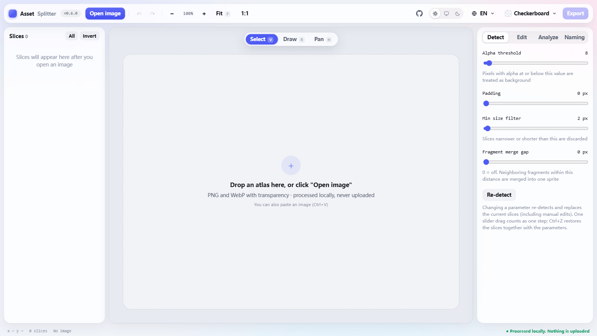
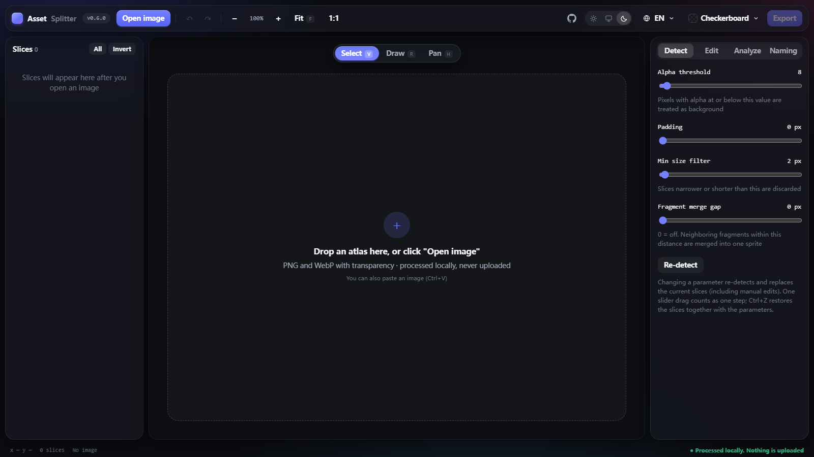

# Asset Splitter

把不规则的精灵图（sprite sheet）切成一个个独立的 PNG 素材。纯前端、单文件、完全离线，图片只在你的浏览器里处理，不会上传到任何地方。

当前版本：**0.6.0** · 更新记录见 [CHANGELOG.md](CHANGELOG.md) · 仓库：<https://github.com/zengtai/asset-splitter>

## 特性

- **自动检测**：按透明通道识别每个独立素材，可调 Alpha 阈值、外扩 Padding、小切片过滤、碎片合并距离，调参实时预览。
- **手动修正**：框选新建（可吸附到不透明边缘）、合并、删除、方向键微调、直接改坐标和尺寸。
- **批量选择**：空白处拖动框选、列表连选和加选、全选、反选。
- **切片分析**：尺寸分布、重复切片、过小、过大、贴边、极端长宽比、半透明占比高，点击即可选中并批量处理。
- **导出**：单个导出 PNG，多个或全部打包 ZIP；自定义命名前缀。
- **撤销与重做**：最多 100 步。
- **浅色与深色主题**：默认跟随系统，也可手动切换，选择会被记住。
- **多语言**：简体中文、繁體中文、English、日本語、한국어、Español、Deutsch、Français，首次打开按浏览器语言选择，顶栏可随时切换，选择会被记住。
- **离线可用**：没有构建步骤、没有依赖，下载 HTML 文件直接打开即可。

## 快速开始

1. 下载仓库中的 `asset-splitter.html`，用浏览器打开（Chrome、Edge、Firefox、Safari 的较新版本均可）。
2. 把图集拖进窗口，或点击“导入图集”，也可以直接 `Ctrl+V` 粘贴图片。
3. 自动检测完成后，在左侧列表和画布上检查结果，必要时在右栏调整检测参数。
4. 点击“导出全部 ZIP”，或选中部分切片后，可在“命名”标签页只导出选中的。

> 输入图片需要带透明通道（PNG、WebP）。没有透明像素的图片无法自动检测，但仍可以用“框选”手动切。

## 主题

顶栏右侧的三个图标依次是 **浅色**、**跟随系统**、**深色**。默认跟随系统，系统在明暗之间切换时界面会自动跟着变；手动选择后，偏好保存在浏览器本地（`localStorage`），下次打开保持不变。画布背景、棋盘格和切片框的颜色也会随主题一起切换。

| 浅色 | 深色 |
| --- | --- |
|  |  |

## 使用说明

### 界面布局

- **左栏**：切片列表，显示缩略图、尺寸和位置；支持多选、双击重命名、全选和反选。
- **中间**：画布。顶部浮动工具条切换“选择、框选、平移”；滚轮缩放，缩放比例显示在顶栏。
- **右栏**：四个标签页。
  - **检测**：Alpha 阈值、外扩 Padding、小切片过滤、碎片合并距离。
  - **编辑**：选中切片的名称、坐标、尺寸；框选吸附开关；合并与删除。
  - **分析**：概览、尺寸分布、问题检查、选中切片详情。
  - **命名**：命名前缀、导出选中；导出全部请用顶栏的“导出”按钮。
- **顶栏**：导入、撤销与重做、缩放、GitHub 链接、语言（下拉）与主题切换、预览背景切换、导出全部。
- **状态栏**：光标像素坐标、选中信息、图集尺寸，以及“全程本地处理”的提示。

### 快捷键

| 操作 | 快捷键 |
| --- | --- |
| 选择 / 框选新建 / 平移 | `V` / `R` / `H`（按住 `Space` 或鼠标中键也可临时平移） |
| 缩放 | 滚轮 |
| 适应窗口 / 100% | `F` / `1` |
| 撤销 / 重做 | `Ctrl+Z` / `Ctrl+Shift+Z`（或 `Ctrl+Y`） |
| 全选 / 反选 | `Ctrl+A` / `Ctrl+I` |
| 合并选中 | `M` |
| 删除选中 | `Delete` 或 `Backspace` |
| 取消选择 | `Esc` |
| 微调选中切片 | 方向键（`Shift` 一次 10px） |
| 加选 | 画布 `Shift` 或 `Ctrl` 点击；列表 `Ctrl` 点击 |
| 连选 | 列表 `Shift` 点击 |

在选择工具下，于画布空白处按住鼠标拖动即可框选多个切片。

### 检测参数

| 参数 | 作用 | 默认值 |
| --- | --- | --- |
| Alpha 阈值 | 透明度不高于该值的像素视为背景 | 8 |
| 外扩 Padding | 每个切片向四周多保留的像素数 | 0 |
| 小切片过滤 | 宽或高小于该值的切片被丢弃，用来去掉噪点 | 2 |
| 碎片合并距离 | 距离在该值内的相邻碎片合并为一个素材，0 为关闭 | 0 |

检测规则：先按 8 连通域找出所有不透明区域，再按合并距离合并碎片，丢弃过小的区域，最后加上 Padding（不会超出图集），按从上到下、从左到右排序。调整任何参数都会重新检测并替换当前切片（包括手动编辑）；拖动一次滑块算一步历史，撤销会连同参数一起还原。已有手动编辑时导入新图集会先确认。

### 分析与问题检查

“分析”标签页会给出下面几类提示，点击任一项即可选中对应切片，再按 `Delete` 批量清理：

| 检查项 | 判定规则 |
| --- | --- |
| 重复切片 | 尺寸相同且像素内容完全一致；“多余副本”为每组去掉第一个之后剩下的 |
| 过小 | 宽或高小于 8px，或面积小于中位数面积的 10% |
| 过大 | 面积超过中位数面积的 8 倍，可能是误合并 |
| 触及图集边缘 | 素材像素贴着图集边界，可能被裁切 |
| 极端长宽比 | 长边与短边之比大于 8 |
| 半透明占比高 | 半透明像素占不透明像素的一半以上，可能是阴影或光晕 |

选中单个切片后，还能看到不透明像素数、填充率、半透明占比、平均 Alpha、主色和紧凑包围盒，并可一键“收紧到不透明边缘”。

### 导出规则

- 选中 1 个切片导出为单张 PNG；多个或全部则打包为 ZIP。图集里只有 1 个切片时，“导出全部”也是单张 PNG。
- 按钮文案会如实反映结果：例如“导出选中 · PNG”“导出选中 · ZIP（3）”“导出全部 ZIP（6）”；“命名”标签页下方会预告将生成的文件名。
- 顶栏的导出按钮始终导出全部切片；只导出部分切片，请在“命名”标签页使用“导出选中”。
- 文件名为“命名前缀 + 三位序号”，如 `sprite_001.png`；手动改过名字的切片使用你设定的名字，重名会自动加 `_2`、`_3` 后缀。
- 命名前缀默认取图集文件名，可在“命名”标签页修改。
- ZIP 使用不压缩（存储）方式打包，文件名按 UTF-8 编码，中文名可正常解压。

## 已知限制与计划

目前只处理一张图集，输入限于带透明通道的 PNG 和 WebP，大图检测在主线程运行，特别大的图可能短暂卡顿，并占用较多内存（4096×4096 级别的图集需要数百 MB）。

计划中的功能：

- [ ] 局部重新检测（框选区域内用新参数重跑）
- [ ] 导入 JSON、XML plist、文本 atlas 描述文件，按描述精确切图
- [ ] 会话自动保存与恢复
- [ ] 用 Web Worker 处理大图
- [ ] 键盘全流程操作与无障碍完善

暂不计划：导出新的图集描述文件、一次导入多张图集、JPG 输入。

## 隐私

所有图片处理都在浏览器本地完成，图片不会上传。浏览器本地只保存两项偏好：主题和界面语言。界面顶栏的 GitHub 图标只是一个普通链接，点击后才会打开外部页面。

## 开发说明

项目没有构建步骤和依赖，整个应用就是一个 HTML 文件，样式和脚本都内嵌其中。

- **主题**：颜色全部定义为 CSS 变量，`:root` 是浅色，`:root[data-theme=dark]` 覆盖为深色；脚本根据偏好设置 `<html>` 的 `data-theme` 属性。画布绘制时从 `--stage`、`--ck1`、`--ck2`、`--cv-*` 等变量读取颜色，主题切换后会重新读取。新增颜色时请在两套主题里同时定义变量。
- **可测试的纯函数**：脚本中 `//<pure>` 与 `//</pure>` 之间是不依赖 DOM 的函数（`detectBoxes`、`opaqueBBox`、`analyzeSlice`、`makeZip`），可以单独抽出来在 Node 中测试。
- **多语言**：界面文字集中在脚本里的 `I18N` 字典（`zh`、`zh-TW`、`en`、`ja`、`ko`、`es`、`de`、`fr`）。静态文字用 `data-i18n`、`data-i18n-html`、`data-i18n-title`、`data-i18n-aria` 属性标记，动态文字调用 `t(key, vars)`；条目可以是带 `{变量}` 的字符串，也可以是函数（用于英文单复数）。新增文字请在所有语言里同时补全，缺失的键会回退到中文。新增语言时，补一份字典，再把它加进 `LANGS` 和 `HTML_LANG`。条目用函数写法时，可借助 `pl(n, 单数, 复数)` 处理单复数。
- **版本号**：写在顶栏徽标和文件开头的注释里，发布新版本时请一并更新，并在 [CHANGELOG.md](CHANGELOG.md) 中追加记录。

## 许可证

尚未指定。
